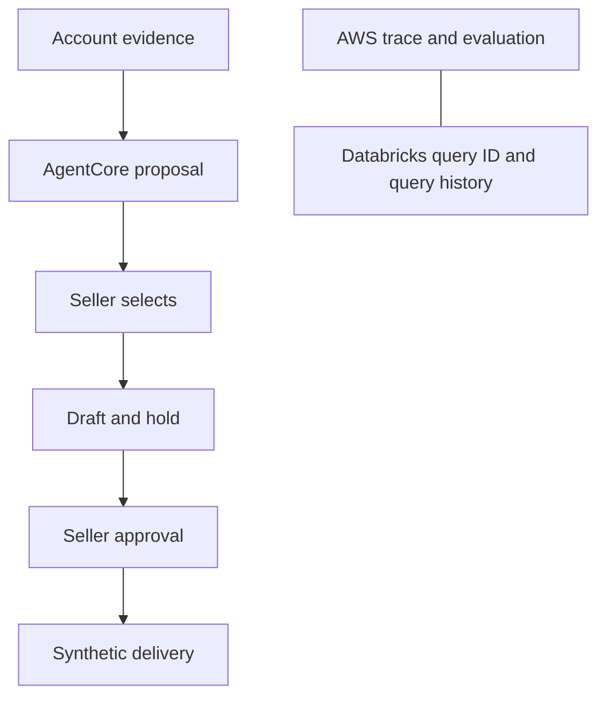

# Premium sales: decisions and architecture research

Status: **Decision record.** Product choices are settled. Architecture is proposed. Research date: **2026-10-15**.

## Goal

One premium seller covers Northern California, Oregon, and Washington. The seller sees proactive renewals, leads, and upsells, then chats about an account or regional analytics. Evidence supports a recommendation. The seller controls every release.

Evidence informs the seller. The seller controls release.

<!-- digest:start -->
The target is a 10 to 15 minute demo with 10,000 synthetic Ticketmaster records. The planned system joins Databricks evidence to an AgentCore Harness. The current mock is a browser-only presentation.
<!-- digest:end -->

## What is settled

| Area | Decision | Reason |
| --- | --- | --- |
| Seller | One seller owns the CA, OR, and WA account scope. | The demo needs one clear user and no hierarchy. |
| Proactive work | A schedule will run the scan. A manual **Scan now** trigger runs it now. | The seller can demonstrate proactive and on-demand work. |
| Renewal rule | A stalled renewal is due within 30 days, unsigned, and has no reply for 14 days. | The rule is narrow and reviewable. It is not a universal attention rule. |
| Leads | A lead needs no renewal date or season history. | Discovery starts from the buyer signal. |
| Gift policy | Gifts are selective and unconditional relationship gestures. | A gift is not a conditional renewal benefit. |
| Artist relation | Store public **ListenBrainz API** catalog evidence in Databricks. | It separates public artist relations from customer preference. |
| Similarity claim | Use an evidence-labeled qualitative inference. Do not state a probability or score. | No validated customer outcome model exists. |
| Release | A seller selects an option. The system makes a hold and draft. Seller approval precedes delivery or spend. | A server check controls the business action. |
| Demo proof | Use AWS traces and evaluations, plus Databricks query history. | The consoles show service evidence without another panel. |
| Data size | Use 10,000 synthetic Ticketmaster records. | This shows the design without an enterprise benchmark claim. |

## Decision record: Q1 to Q16

| Question | Final answer | Why |
| --- | --- | --- |
| Q1. What starts the story? | A renewal case starts it. | The seller gets a concrete next action. |
| Q2. What is wrong at Smith? | Smith is slow to renew. | Do not invent dissatisfaction. |
| Q3. Why offer a gift? | It is an unconditional relationship gesture. | It is not a conditional renewal benefit. |
| Q4. Who starts research? | The agent scans first. | The seller receives prepared help. |
| Q5. How do options source? | Use allocation first. A purchase needs review. | Availability and cost remain honest. |
| Q6. How does artist similarity work? | ListenBrainz catalog evidence replaces early mixed direct and inferred personal evidence. | It needs no embeddings. |
| Q7. Which renewals stall? | Due within 30 days, unsigned, no reply for 14 days. | The rule has observable facts. |
| Q8. When can an action occur? | Selection holds and drafts. Approval releases. | Seller control precedes action. |
| Q9. Which systems are real? | Databricks and AgentCore are targets. CRM, holds, and delivery are planned synthetic services. | The system boundary stays clear. |
| Q10. Who uses it? | One regional seller. | No manager view exists. |
| Q11. How does a scan start? | Schedule plus Scan now. | Both use the same workflow. |
| Q12. How long is the demo? | 10 to 15 minutes. | It covers seller value and technical proof. |
| Q13. How much data? | 10,000 synthetic ticket records. | Measure it. Do not overclaim scale. |
| Q14. What does the seller see? | Account scan, selected-account chat, and account or regional questions. | The seller reviews evidence in context. |
| Q15. Where is technical proof? | AWS and Databricks consoles. | Use the real service views. |
| Q16. What can chat answer? | Customer and broad regional questions. | Fixed rules and analytics have separate paths. |

## Later changes that supersede the early record

- The old risk phrase is corrected to **dragging feet**. It does not imply a hidden account problem.
- The early Q6 mixed direct and inferred personal-evidence choice changed to **ListenBrainz API** catalog evidence.
- The early dashboard-first Q14 choice changed to a scan-first overview and a large selected-account chat.
- The first screen has no attention list. A simulated scan exposes all 10 items.
- **Back to overview** keeps the scan results. Filters show All 10, Renewals 6, New leads 3, and Upsells 1.
- The user removed `SAMPLE BRIEF`, `INDEPENDENT DEMO`, and fictional or synthetic disclaimer bars from the UI. Do not restore them.
- A documentation statement about current and planned behavior remains necessary. It does not require a UI label.
- An earlier "confirm this record" request did not grant a blanket implementation approval. This decision record captures choices. It does not create a new confirmation gate.

## Current mock and planned target

| Capability | Current committed mock | Planned target |
| --- | --- | --- |
| Data | Static browser account data. | Databricks tables and prepared evidence queries. |
| Scan | Timers reveal prepared cards. | Scheduled scan plus manual trigger. Frequency remains open. |
| Chat | Canned account replies and draft text. | AgentCore session with account context and tools. |
| Analytics | No freeform analytics. | Curated read-only Genie One for broad questions. |
| Holds and delivery | No live hold, spend, email, or delivery. | Server-stored draft and hold state. Seller approval checks before synthetic release. |
| Evidence | Browser text and public labels. | Query IDs, trace IDs, on-demand evaluation, and measured query facts. |
| Scale | The mock does not measure 10,000 records. | A 10,000-record synthetic dataset with recorded measurement. |

The current mock is self-contained. This statement does not describe other repository AWS work. It only describes the committed premium-sales mock.

## The ten account scenarios

The committed prototype at [premium-sales/index.html](../../prototypes/premium-sales/index.html) is the source of current UI behavior. It contains the complete fixtures and presentation copy.

| Account | Type and signal | Seller action | Limit |
| --- | --- | --- | --- |
| Smith & Smith, Toyota Amphitheatre | Renewal due in 18 days. John Smith has no reply for 17 days. Synthetic U2 purchases and scans support a relationship gift. | Use two allocated U2 Levi's Stadium tickets first. Consider Depeche Mode at The Masonic as a ListenBrainz related-artist candidate. | Arcade Fire at Shoreline has no verified relation. A gift stays unconditional. |
| Cedar & Co., Hayden Homes Amphitheater | Mara replied two days ago and asked for a calendar and guest packages. | Send requested choices and arrange a short review. | Show choices and guest count remain unknown. |
| Northline Partners, White River Amphitheatre | Daniel replied one day ago with a budget concern. | Ask for budget and guest needs. Compare a smaller scope. | No discount is approved. |
| Meridian Advisory, Shoreline Amphitheatre | Priya accepted a quote. The agreement is unsigned. | Confirm the signer and signature date. | Acceptance does not equal signature. |
| Summit Design Group, Toyota Pavilion at Concord | Nina Park replaces Leo Martinez. | Confirm Nina's authority, needs, and timeline. | Do not assume the approval path. |
| Cascade Health Group, Cascades Amphitheater | Avery replied three days ago about underused tickets. | Review use and build a right-sized option. | Do not propose a gift by default. |
| Evergreen Ventures, Gorge Amphitheatre | Sophie made an inbound inquiry. | Discover guests, budget, timing, and authority. | An inquiry is not a qualified opportunity. |
| Columbia Ridge Capital, BECU Live at Northern Quest | Grant is an outbound prospect with no contact or history. | Send permission-based outreach. | Do not imply a prior relationship. |
| Alder & Stone, Chateau Ste. Michelle Winery | Naomi requested a site visit. | Check availability and learn visit goals. | Suggested visit times are not confirmed. |
| Redwood Creative, Shoreline Amphitheatre | Taylor has four past artist VIP purchases. The next show is in 12 days. General parking is included. Premier Parking is not included or purchased. | Ask about cars. Check Premier Parking availability and price before a quote. | Parking is optional and one pass applies per car. |

## Architecture recommendation

This section is engineering judgment. It is not an implementation authorization.

<!-- fig:architecture -->

The delivery path is account evidence, AgentCore proposal, seller selection, draft and hold, seller approval, and synthetic delivery. AWS trace and evaluation evidence run beside this path. Databricks query IDs and query history provide separate query proof.

1. Use a managed **AgentCore Harness**. The server owns model configuration, approved tool definitions, session credentials, and IAM permissions.
2. Use deterministic prepared SQL or Unity Catalog functions for renewal rules and account evidence. Join approved tables through stable IDs, not names.
3. Use a curated, read-only **Genie One** route only for broad regional analytics. It is not required for the scheduled scan.
4. Separate orders, tickets, scans, contracts, contacts, activity, entitlements, inventory, and artist relations in Databricks. The stable identity link controls customer evidence.
5. Refresh a public ListenBrainz catalog with artist IDs on a schedule. Cache the result in Databricks. Do not send John or his purchase history to an external catalog.
6. Store drafts, holds, approvals, and delivery records on the server. A draft is a write operation. A hold occurs before approval. Delivery occurs after approval.
7. Check approval, inventory freshness, and an idempotency key in code before a spend or synthetic release. A model Boolean must not authorize it.
8. Use Runtime session isolation, IAM authorization, and a narrow tool allowlist. `allowedTools` limits model selection. It does not block direct runtime-command APIs. Omit that IAM permission by default.
9. Show AWS trace and on-demand evaluation evidence in AWS. Show query history in Databricks. Correlate query IDs where possible. No unified technical dashboard is proposed.

### Architecture limits

- A Gateway policy can add controls, but no source requires it for every tool.
- No embedding system is necessary for this small catalog. Add preaggregation only after measured warehouse need.
- The U2 public query read on 2026-10-15 returned Depeche Mode. It did not return Arcade Fire. Absence in that response is not negative evidence.
- ListenBrainz returns a relationship candidate, not a customer probability. The external source supports no claim about John's intent.

## Evidence and measurements

Record actual elapsed time, rows, bytes, and warm or cold cache state. A 10,000-record demonstration proves design fit only. It does not prove enterprise performance or cost.

Evaluate the target against these fixtures:

- Direct U2 history and inferred Depeche Mode evidence stay distinct.
- A wrong identity link produces no customer history result.
- A recent reply produces a reply action, not a stalled-renewal action.
- A lead works without season history or a renewal date.
- An already-included upsell benefit does not create an offer.
- An unapproved release is blocked.
- A repeated delivery request cannot create a duplicate delivery.

### Measurement record

Capture these facts for each demonstrated scan or question.

| Fact | Purpose | Do not claim |
| --- | --- | --- |
| Query ID | Links the result to Databricks query history. | A cross-system trace without correlation evidence. |
| Rows read and returned | Shows the real query scope. | That one result represents production load. |
| Bytes read | Helps identify warehouse cost and scan shape. | A fixed cost before measurement. |
| Elapsed time | Shows the observed query result. | A hard latency service level. |
| Cache state | Separates cold and warm observations. | That either state always applies. |
| Trace ID | Links the interaction to AgentCore observability. | That tracing alone validates business logic. |
| Evaluation result | Checks a selected trace or span. | That one evaluation proves broad reliability. |

### Approval path

The authenticated seller selects an option. The server prepares the draft and hold. The seller then approves the specific action in the UI. The server validates approval and inventory, then releases once or refuses a duplicate. The browser cannot supply arbitrary model or tool configuration, or an untrusted `approved=true` value.

### Why the routes differ

The renewal scan follows a fixed business rule. Prepared SQL or a Unity Catalog function makes its inputs, joins, and limits inspectable.

Broad analytics asks open business questions across curated data. Genie One is proposed only for that route because it supports read-only natural-language analysis under Unity Catalog permissions.

The tool allowlist limits which tools the model can choose. IAM separately limits what the runtime identity can do. Both controls are required.

## Research findings and design judgment

### AgentCore

**Verified fact.** AgentCore Harness provides managed agent execution, tools, sessions, traces, logs, and metrics. Harness tools can use inline functions that execute in the application client or remote MCP tools. A Gateway is optional for remote MCP use. [Harness tools](https://docs.aws.amazon.com/bedrock-agentcore/latest/devguide/harness-tools.html)

**Engineering judgment.** Keep all application tools server-owned. Give the browser no model or server credentials. The authenticated seller approves in the UI. The server validates that approval, executes tool functions, and stores action state.

**Verified fact.** `allowedTools` scopes model tool selection. It does not replace IAM and does not block direct runtime-command APIs. Omit `InvokeAgentRuntimeCommand` from the runtime identity when the application does not need it. [Harness security](https://docs.aws.amazon.com/bedrock-agentcore/latest/devguide/harness-security.html)

**Verified fact.** Harness emits traces automatically after Transaction Search setup. AgentCore offers online, on-demand, and batch evaluations. [Harness operations](https://docs.aws.amazon.com/bedrock-agentcore/latest/devguide/harness-operations.html) and [evaluation types](https://docs.aws.amazon.com/bedrock-agentcore/latest/devguide/evaluations-types.html)

**Engineering judgment.** An on-demand evaluation best fits one selected demo trace.

### Databricks

**Verified fact.** Databricks supports predefined parameterized logic through Unity Catalog functions. It supports Genie One for curated natural-language questions. Genie One is generally available and checks Unity Catalog permissions. [Unity Catalog functions](https://docs.databricks.com/aws/en/agents/custom-agents/create-custom-tool) and [Genie One MCP](https://docs.databricks.com/aws/en/agents/mcp-tools/genie-mcp)

**Verified fact.** The prior Genie MCP endpoint at `/api/2.0/mcp/genie` sunsets on 2026-10-31. Use the current Unity Gateway route when integration work begins. [Genie One MCP](https://docs.databricks.com/aws/en/agents/mcp-tools/genie-mcp)

**Engineering judgment.** Build one bounded query adapter. It supplies typed parameters, row limits, and byte limits. It also checks a Statement Execution result state because failed SQL can return HTTP 200 with `status.state` set to `FAILED`. [Statement Execution API](https://docs.databricks.com/api/statement-execution/v1/execute-statement)

### Public artist catalog

**Verified fact.** ListenBrainz artist radio accepts a MusicBrainz artist ID and returns related-artist candidates. Its response does not document an artist-pair similarity score. [ListenBrainz core API](https://listenbrainz.readthedocs.io/en/latest/users/api/core.html)

**Observed result.** The 2026-10-15 public read from U2 returned Depeche Mode. The same response did not return Arcade Fire.

**Engineering judgment.** Cache public catalog rows with source, retrieval date, seed artist ID, candidate artist ID, and relation type. The seller can state the source distinction and uncertainty. The relation alone is not a calibrated prediction about the customer. A seller can make an evidence-labeled qualitative inference.

### Sales workflow research

**Verified fact.** Public LN Premium pages describe season seats, partial packages, memberships, group experiences, and an inquiry flow. They do not describe internal seller rules or any fixture. [Premium Experiences](https://premium.livenation.com/experiences) and [Build Your Experience](https://premium.livenation.com/buildyourexperience?linkId=100000216054386&venue=193)

**Engineering judgment.** Use observable signals and next actions. A reply becomes a reply action. A contact change becomes a stakeholder check. A budget concern becomes a scope conversation. These states are not predictions. [Salesforce pipeline guidance](https://www.salesforce.com/sales/pipeline/)

## Unresolved technical checks

These checks guide implementation. They are not a new approval gate.

- Verify the target workspace identity, AgentCore model access, and exact Databricks access path.
- Test Unity Catalog permissions, stable identity mappings, and read-only Genie One scope.
- Check the scheduled catalog refresh rate and source provenance retention.
- Measure the warehouse before a cache or preaggregation design.
- Verify trace, on-demand evaluation, query-history access, and query-ID correlation.
- Choose scan frequency after data cadence and warehouse behavior are known.

## Reference document summary

### Databricks + AI Agents for Live Nation Premium Sales

The attachment proposes bronze, silver, and gold curation. Bronze holds raw source data. Silver cleans names, venues, scans, and account links. Gold exposes business-ready account summaries and metric views. It recommends gold-only agent access and one central metric definition for people, dashboards, Genie, and agents.

It recommends Unity Catalog functions for repeatable decisions and Genie for open exploration. It identifies SQL MCP as a development-oriented route with write risk. It treats skills as playbooks, not enforcement. Permissions and application code must enforce hard rules such as no release without approval.

It recommends a one-agent default, clear data identity, evaluations, and a small tool set. It also suggests serverless warehouses, liquid clustering, predictive optimization, and preaggregation for recurring large-scale questions. The selected demo adopts narrow deterministic queries and identity links. It does not adopt preaggregation before measurement.

The attachment uses utilization, late payment, and no-contact examples as possible account-risk inputs. They are proposals in that source. This demo does not adopt them as the universal scan rule. The selected stalled-renewal rule remains due within 30 days, unsigned, and no reply for 14 days.

The attachment recommends MLflow 3 for evaluation. This demo selects AgentCore traces and on-demand evaluations because the planned agent runtime is AgentCore. That selection does not reject later Databricks evaluation work.

### Live Nation venues summary

The attachment supplies this regional reference list.

| Venue | City | State |
| --- | --- | --- |
| Shoreline Amphitheatre | Mountain View | CA |
| Toyota Amphitheatre | Wheatland | CA |
| Toyota Pavilion at Concord | Concord | CA |
| The Masonic | San Francisco | CA |
| Hayden Homes Amphitheater | Bend | OR |
| BECU Live at Northern Quest | Airway Heights | WA |
| Cascades Amphitheater | Ridgefield | WA |
| Chateau Ste. Michelle Winery | Woodinville | WA |
| Gorge Amphitheatre | George | WA |
| White River Amphitheatre | Auburn | WA |

It describes nine as outdoor seasonal venues and The Masonic as an indoor year-round venue. It proposes season packages, boxes, club packages, groups, and private events as useful commercial context. It also notes that amenities and parking vary by venue and package. The current mock treats general parking as usually included and Premier Parking as a separate sale. The [Shoreline venue page](https://www.livenation.com/venue/KovZpZA6ta1A/shoreline-amphitheatre-events) presents Premier Parking as an upgrade. The [LN Premium FAQ](https://premium.livenation.com/faq) describes premium packages that can include parking.

The attachment's national 95-venue list is context only. It does not verify Live Nation ownership, current inventory, or commercial control for every venue. The current product scope is the ten regional fixtures. Customer records and event scenarios are fictional. Public venue and catalog facts need independent cited sources.

## Research basis

Facts in this document use the sources below. The architecture recommendation is an inference from those facts and the demo constraints.

- AWS documents Harness as a managed agent loop with managed runtime, sessions, observability, and tools. [AgentCore Harness](https://docs.aws.amazon.com/bedrock-agentcore/latest/devguide/), [Harness security](https://docs.aws.amazon.com/bedrock-agentcore/latest/devguide/harness-security.html), and [evaluation types](https://docs.aws.amazon.com/bedrock-agentcore/latest/devguide/evaluations-types.html).
- Databricks separates predefined parameterized logic, natural-language Genie questions, and query execution. [Structured data tools](https://docs.databricks.com/aws/en/agents/custom-agents/structured-retrieval-tools), [Unity Catalog functions](https://docs.databricks.com/aws/en/agents/custom-agents/create-custom-tool), and [Genie One MCP](https://docs.databricks.com/aws/en/agents/mcp-tools/genie-mcp).
- Query history can provide execution evidence. [Query History API](https://docs.databricks.com/api/query-history/v1/list-queries) and [query history system table](https://docs.databricks.com/aws/en/admin/system-tables/query-history).
- ListenBrainz artist radio provides related artists and asks clients to use a valid User-Agent and rate limits. [ListenBrainz core API](https://listenbrainz.readthedocs.io/en/latest/users/api/core.html) and [API guide](https://listenbrainz.readthedocs.io/en/latest/users/api/).
- Public Live Nation pages describe premium experiences and request flows. They do not verify the fictional fixtures. [Premium Experiences](https://premium.livenation.com/experiences), [Build Your Experience](https://premium.livenation.com/buildyourexperience?linkId=100000216054386&venue=193), and [Premium FAQ](https://premium.livenation.com/faq).

## Document links

The Markdown record is authoritative. The local digest projects it without a second source of truth.

- Current product mock: [premium-sales/index.html](../../prototypes/premium-sales/index.html)
- Prototype server: [serve.ts](../../prototypes/premium-sales/serve.ts)
